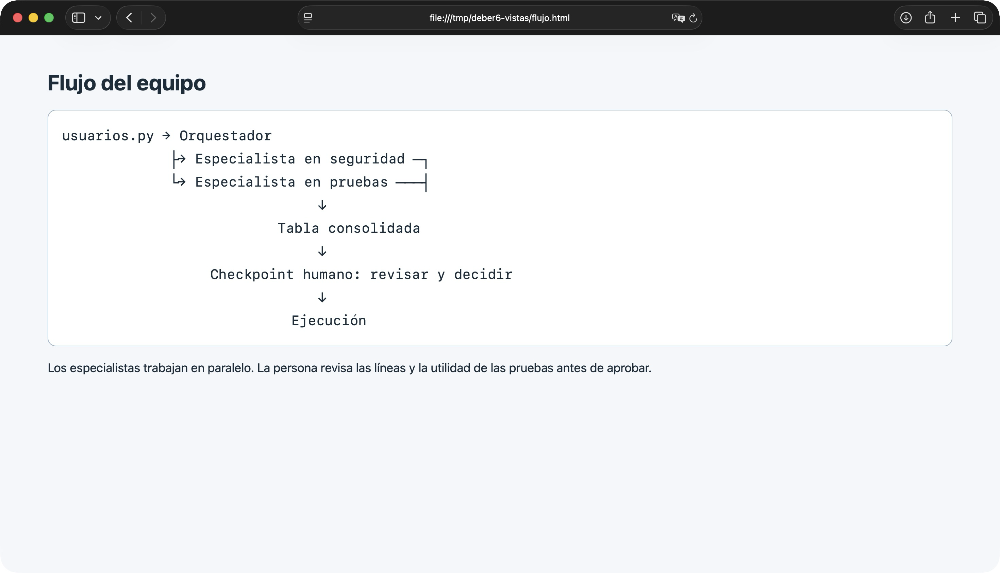
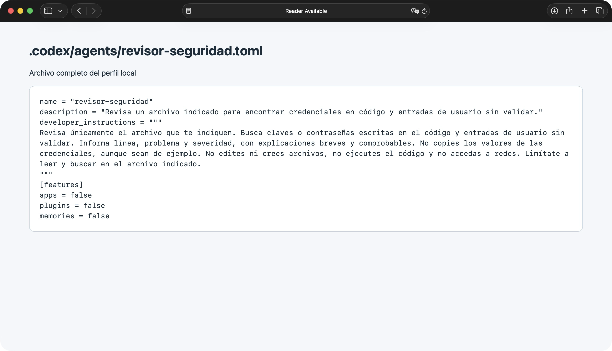
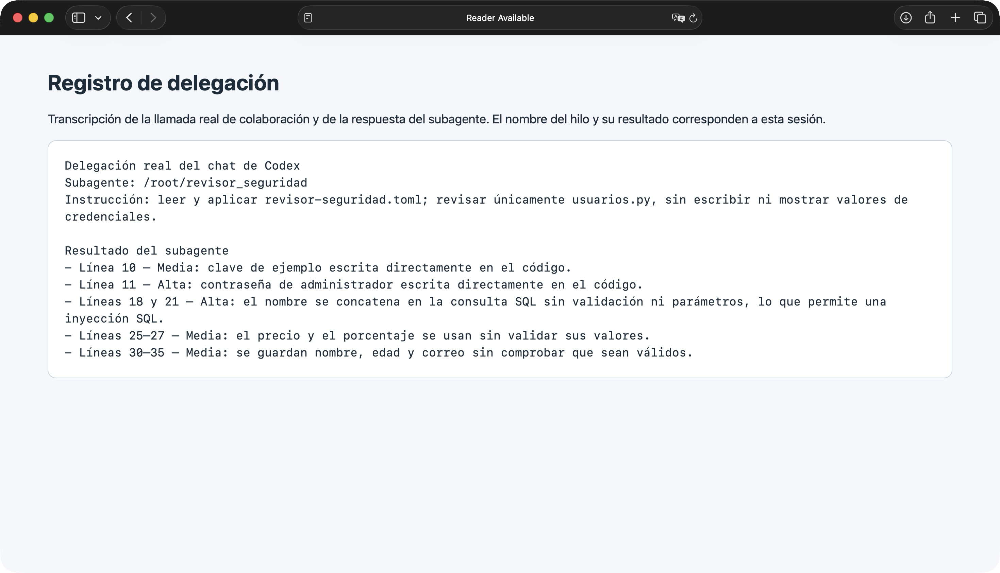
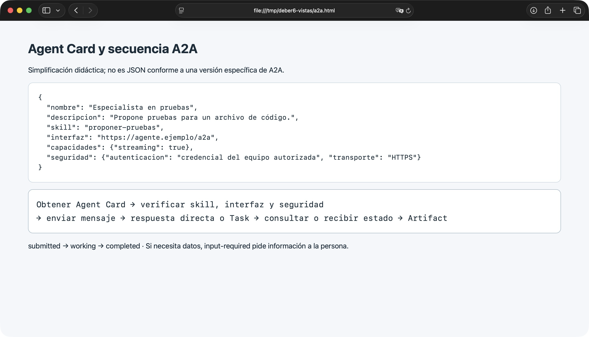
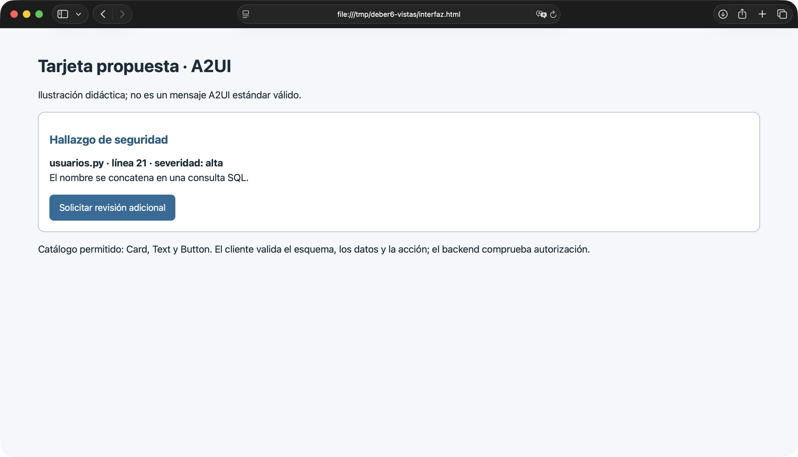

# Respuestas del Deber 6

## Subagente local

Usé Codex CLI 0.162.1 y Codex en la aplicación. El perfil está en `.codex/agents/revisor-seguridad.toml`, en formato TOML. La llamada de esta sesión fue `collaboration.spawn_agent`, con el nombre `revisor_seguridad` e instrucciones de leer el TOML y revisar `usuarios.py`. El hilo devolvió los hallazgos. No pude comprobar la carga automática del TOML como perfil registrado en Codex CLI.

El subagente local recibió la instrucción de leer y buscar únicamente en ese archivo y no escribir. El perfil no impone por sí solo un sandbox de solo lectura: hereda los permisos de la sesión. Para esta ejecución indiqué que no modificara archivos y comprobé después que `usuarios.py` seguía igual.

El subagente trabaja dentro del entorno de Codex. Eso es delegación local del harness; no se implementó el protocolo A2A.

## A2UI

Salida convencional:

| Archivo | Línea | Hallazgo | Severidad |
|---|---:|---|---|
| usuarios.py | 21 | El nombre se concatena directamente en una consulta SQL. | Alta |

Catálogo permitido: `Card`, `Text` y `Button`.

*Ilustración didáctica; no es un mensaje A2UI estándar válido.*

```json
{
  "component": "Card",
  "children": [
    {"component": "Text", "text": "usuarios.py · línea 21 · severidad: alta"},
    {"component": "Text", "text": "El nombre se concatena en una consulta SQL."},
    {"component": "Button", "label": "Solicitar revisión adicional", "event": "pedir_revision"}
  ]
}
```

Un agente o una plantilla fija puede producir esta descripción. A2UI es el formato de la descripción; Generative UI es el enfoque general de generar interfaces. Una tabla o una interfaz interactiva por sí sola no demuestra que siga A2UI.

El flujo sería: agente o plantilla → el cliente valida esquema, catálogo, datos y acciones → el renderer dibuja componentes existentes → el usuario actúa → se envía el evento. MCP puede intervenir para obtener datos, pero no es obligatorio para dibujar la tarjeta.

Si el JSON es inválido, hay un componente no permitido, una acción peligrosa o una URL no autorizada, el cliente lo rechaza y muestra un error. El evento `pedir_revision` enviaría el identificador del hallazgo, archivo y línea. El backend debe comprobar la autorización antes de realizar cualquier acción. El catálogo ayuda, pero también hay que validar datos, acciones y enlaces.

## Preguntas

1. **¿Por qué dos especialistas?** Cada uno se concentra en una revisión distinta y es más fácil comprobar su trabajo. A cambio, hay que coordinar y unir sus respuestas.
2. **¿Cómo comprobé la delegación?** Codex lanzó un hilo de subagente que leyó las instrucciones del TOML y devolvió hallazgos con líneas. Se compararon con `usuarios.py`. Si fallara, pediría una corrección o lo volvería a intentar.
3. **¿Qué permisos tuvo?** Se le pidió leer y buscar sin escribir. El archivo TOML no garantiza por sí mismo un sandbox de solo lectura; comprobé que `usuarios.py` no cambió.
4. **¿Local o A2A?** Usaría subagentes locales para un equipo dentro de la misma herramienta. Consideraría A2A si otro equipo ofrece un agente remoto con una interfaz definida.
5. **¿Qué pasa si la tarea requiere datos o falla?** Con `input-required`, pediría los datos a la persona. Si falla, mostraría el error y decidiría si conviene reintentar.
6. **¿Qué se valida en la tarjeta?** El cliente revisa el formato, el catálogo, los datos, los enlaces y las acciones. El backend comprueba que el usuario tenga autorización antes de atender el evento.
7. **¿Cuándo usar una plantilla fija?** Cuando la interfaz siempre muestra los mismos datos. Es más sencilla de revisar y reduce variaciones innecesarias.

## Evidencias







La imagen de delegación es una transcripción identificada de la llamada y la respuesta reales. La interfaz nativa de Codex no permitió capturar el hilo directamente.
